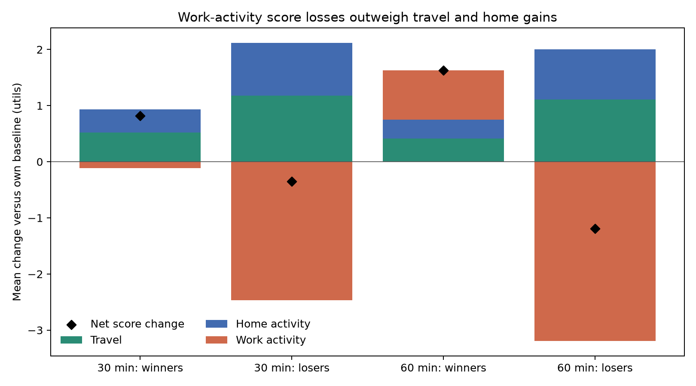
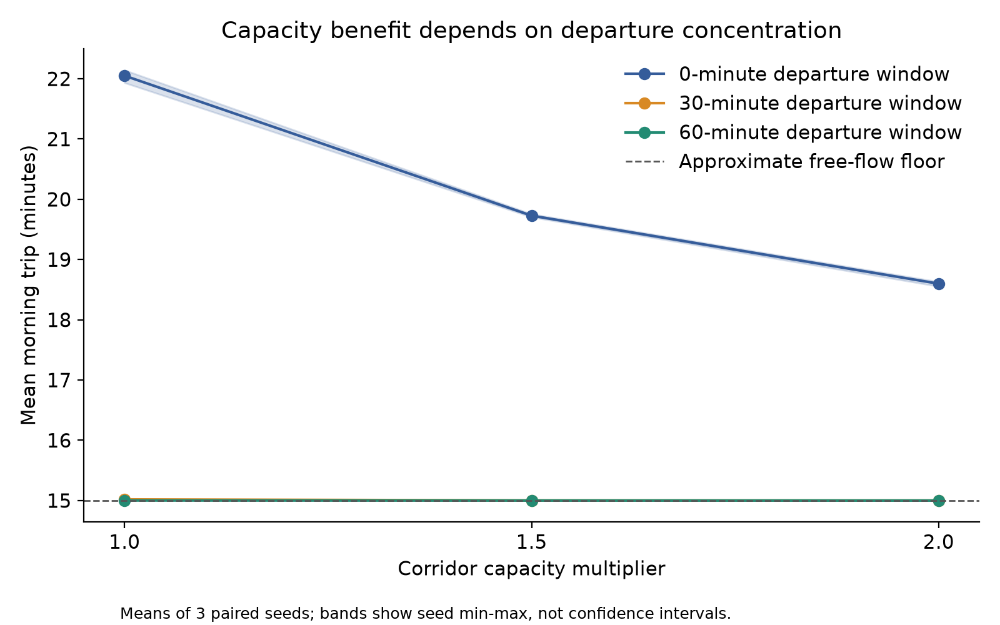
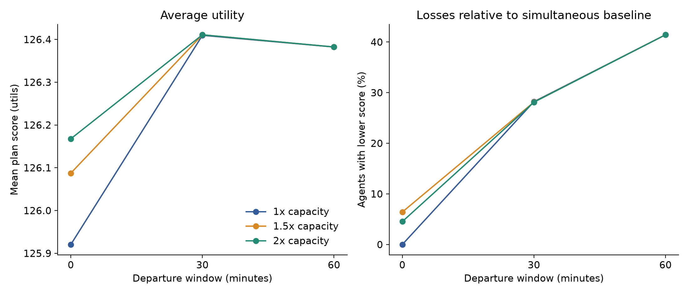
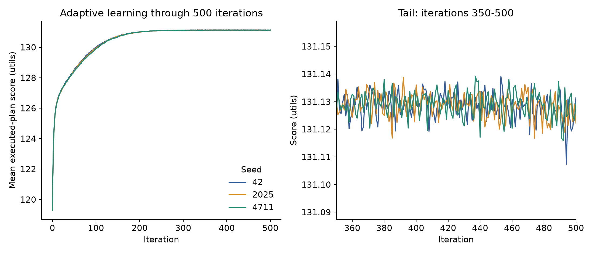

# 补充交通实验结果（独立分支）

日期：2026-11-04。此实验新增结果位于独立分支，未合并至 main。


## 新版演示与得分机制分析

- [新版演示 PPTX](LSGI3213_Equil_Slides_Updated.pptx)：18 页，保留原有研究内容，加入容量/出发窗口敏感性、500 次迭代稳定性检查及个体得分机制。原版演示保持不变。
- [新版演示 PDF](LSGI3213_Equil_Slides_Updated.pdf)
- [新版讲解备注](Updated_Presentation_Notes.txt)：按 15 分钟安排，PPTX 也含逐页备注。
- [得分分析说明](Score_Explanation.txt)与[完整分析包](score_explanation.zip)：代码、逐人数据、分组结果、评分源码及核验记录。

得分拆解核对了 9 个运行的 18,000 条人员记录。所有得分下降者的通勤和家庭活动得分均提高，损失来自工作活动计分时长减少：工作在到达后 8 小时结束，但 07:00 前不计入活动效用。直接等待罚分为零。这解释当前模型中的结果，不代表现实中早出发一定有害。



没有新增仿真。分析包中的“固定轨迹反事实”只重新计算评分，不能当成行为重新调整后的仿真结果。

## 实际运行与核验

- 3 档容量 × 3 档出发窗口 × 3 个配对随机种子，共 27 个网格实验记录。复用 12 个已核验原运行，新增 15 个运行；均采用迭代 0–100。
- 另外将自适应场景用三个种子分别从头运行到迭代 500，新增运行合计 18 次。
- 每次最终日均有 2,000 人、4,000 次完成出行，stuck 为 0。逐人逐次核对事件与原生出行表，并核对实际执行计划得分、正常结束日志及输入哈希。
- 运行使用 MATSim 12.0、Java 14.0.2、每个仿真单线程。复用原结果使用 Java 11；此前两个独立重跑的最终事件与原始结果完全一致。

## 1. 容量和出发窗口的相互影响

下表为三个种子的均值，单位为早晨平均行程分钟。出发窗口中心固定在 06:00。

| 容量 | 同时出发 | 分散 30 分钟 | 分散 60 分钟 |
|---|---:|---:|---:|
| 1 倍 | 22.0521 | 15.0194 | 15.0018 |
| 1.5 倍 | 19.7289 | 15.0022 | 15.0004 |
| 2 倍 | 18.5994 | 15.0009 | 15.0000 |



双倍容量相对同一出发窗口下的原容量，按种子配对比较：

| 已有出发窗口 | 平均节省（秒） | 三种子范围（秒） | 平均节省比例 |
|---|---:|---:|---:|
| 0 分钟 | 207.158 | 199.409–215.428 | 15.655% |
| 30 分钟 | 1.114 | 0.813–1.274 | 0.124% |
| 60 分钟 | 0.107 | 0.090–0.134 | 0.012% |

在原容量下，30 分钟窗口的平均行程为 15.0194 分钟，60 分钟窗口为 15.0018 分钟，两者仅差 1.058 秒；30 分钟窗口的平均日计划得分高出 0.02737 utils。这只支持本次受测组合中的比较，不能宣称 30 分钟是全局最优窗口。

这些结果说明，扩容收益取决于原来是否存在明显拥堵。不能把“同时出发”基准下的收益百分比套用于已经分散出发的交通。分散基准是敏感性假设，没有真实观测数据支持其现实代表性。

## 2. 组合方案为何收益有限

| 设置（原容量，除最后一行） | 平均行程（分钟） | 走廊完整遍历平均延误（秒） | 走廊峰值车辆数（种子均值） |
|---|---:|---:|---:|
| 容量 1 倍 / 窗口 0 分钟 | 22.0521 | 301.0931 | 1775.7 |
| 容量 1 倍 / 窗口 30 分钟 | 15.0194 | 1.1672 | 207.3 |
| 容量 1 倍 / 窗口 60 分钟 | 15.0018 | 0.1212 | 102.7 |
| 容量 2 倍 / 窗口 60 分钟 | 15.0000 | 0.0144 | 101.0 |

原生输出的早晨行驶距离为 25,000 米，道路自由流速度为 27.78 米/秒，对应约 14.9988 分钟；离散仿真中的无拥堵出行约为 15 分钟。该距离采用 MATSim 原生出行距离，避免把活动端点整段道路重复计入。走廊延误仅使用 links 11–19 的完整 entered-link→left-link 遍历。接近自由流时间后，继续增加容量很难再缩短行程。

## 3. 平均收益与个体得分



| 原容量下的窗口 | 平均日计划得分 | 相对同时出发基准的得分下降人数占比 |
|---|---:|---:|
| 0 分钟 | 125.92053 | 0.00% |
| 30 分钟 | 126.40969 | 28.22% |
| 60 分钟 | 126.38231 | 41.43% |

完整个体结果见 `individual_outcomes.csv.gz`；按 15 分钟出发时段划分的结果见 `departure_group_outcomes.csv`。
工作设施 07:00 开放；preopening_gap_min 是到达至开放之间的时间差，不能解释成原生 wait_time，也不能据此断言得分损失完全由等待造成。得分同时受家庭活动时长、工作活动评分等因素影响。这部分初始分组是描述性分析；后续逐人评分机制拆解见页首新增分析包。

## 4. 自适应场景是否已稳定



| 种子 | 100 次得分 | 200 次得分 | 500 次得分 | 最后两段 50 次均值之差 | ≤0.05 utils 筛查 |
|---|---:|---:|---:|---:|---|
| 4711 | 129.91523 | 131.00433 | 131.12970 | -0.00107 | 通过 |
| 42 | 129.97807 | 130.99389 | 131.13149 | -0.00201 | 通过 |
| 2025 | 129.95277 | 131.01487 | 131.12224 | -0.00177 | 通过 |

阈值在新结果完成前设定：比较迭代 451–500 与 401–450 的平均执行得分，绝对差不超过 0.05 utils。它只是明确标注的描述性稳定性检查，不是正式均衡检验。完整尾部范围、斜率及 100/200/300/400/500 次的出发时间与行程指标均保存在 CSV 中。
本次通过该筛查的种子为 3/3；应结合完整曲线解释，不能只因跑到 500 就宣称达到严格均衡。
新长运行的前 101 次得分与对应原始自适应运行一致（绝对容差 1e-9），支持此次延长没有改变前期轨迹。

完整脚本、输入、结果、原生核验证据和文件校验值均见 [下载实验包](experiment_extension.zip)。下载并解压后，在 experiment_extension 目录中运行下列命令。

## 5. 如何复现

需要原工程的 `project` 文件夹及 Java；Python 需要 numpy、pandas、matplotlib。源工程路径应含 runtime、scenarios 和 runs。

```bash
python run_extension.py --source /path/to/project --workers 3
python validate_design.py --source /path/to/project
python analyze_extension.py --source /path/to/project
python make_report.py
```

`run_extension.py` 拒绝覆盖已有但未核验的运行。重跑前请将本补充包中的 runs 文件夹改名归档；原工程无需改动。脚本会在本补充目录中生成输入与输出。发布包保存脚本、输入、结果、图表和精简原生证据；运行引擎使用原工程提供的 runtime。为减少体积，精简证据保留最终事件/出行/计划/得分及自适应检查点出行表，未收录每次迭代的全部重复文件。复用运行的原始事件仍在原工程内。

## 6. 实验边界

- 三个种子用于观察算法随机性；范围不是现实人口的置信区间，也没有进行显著性宣称。
- 人口需求保持 2,000 人，未测试需求增长、方式选择、真实路网、扩容成本或实施可行性。
- 出发窗口按原有个人顺序分配，没有增加随机分配时段的实验；个体得失也受该分配方式影响。
- 容量变化不改变车道数或道路存储空间；结果不能直接当作真实道路拓宽评估。
- 补充实验检查容量和时间窗口交互，后续分析还原了评分机制；没有重新仿真其他开放时间或评分参数下的行为反应。
- 技术结果可复现并不自动证明实验假设适合某个真实城市。
